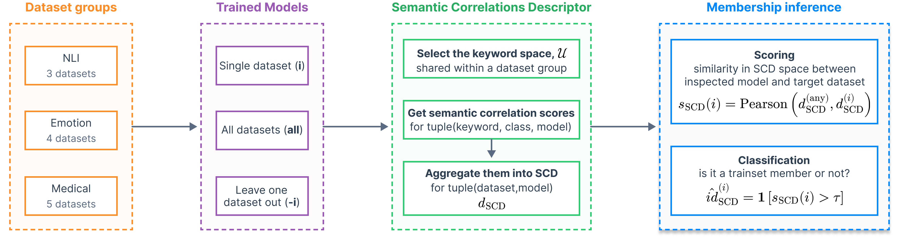

# Repository for "idSCD: Identifying Training Datasets through Semantic Correlation Descriptors" (NeurIPS 2026)

[\[ArXiv\]](https://arxiv.org/abs/2605.30462)

**Authors**: Andrada Gobeaja, Ionut Hodoroaga, Marius Leordeanu, Elena Burceanu

**Abstract**: Can a dataset be recognized from the spurious correlations it induces during training? We argue that datasets leave dataset-specific traces in a model's learned semantic correlation structure: incidental regularities that are predictive within a dataset, but not causal for the underlying task, can be internalized during training. We use this insight to study dataset-level membership inference, moving beyond existing methods that rely on behavioral or distributional evidence such as confidence scores, losses, margins, generated samples, or query responses. We introduce a white-box semantic fingerprinting approach based on semantic correlation descriptors (SCDs), which capture the semantic correlation structure learned by a model and make it comparable across dataset mixtures. In a controlled leave-one-dataset-out diagnostic, SCDs recover dataset-specific changes and perfectly separate matching from non-matching dataset pairs. We then propose a practical SCD-based membership score that tests whether a target dataset is part of a model's training mixture using only the model's SCD and the target dataset's standalone SCD, without requiring leave-one-dataset-out models. Across three diverse experimental settings, with dataset groups for natural language inference, emotion classification, and medical text classification, we test both the advantages and limitations of SCD-based membership inference with different degrees of semantic separation and keyword support between dataset splits. On average, the classifier based on this score achieves the highest performance and the lowest std, outperforming black-box baselines RMIA, Attack-P, and LiRA, as well as the white-box SIF baseline. These results show that dataset membership can be traced through internal semantic correlations, with the largest relative gain exceeding 60% in ROC-AUC when dataset groups expose distinct semantic particularities.

## Approach

<p align="center">
  
</p>

For a classifier $m$ with label set $\mathcal{Y}$, the **semantic correlation descriptor** (SCD) records how strongly each keyword $u$ is tied to each class $y$ in the model's representation space:

1. **Keywords.** YAKE extracts the top-$k$ keywords ($n \le 3$) from the model's training texts. Their union over all models forms a shared vocabulary $U$.
2. **Class vectors.** $w_y$ are the L2-normalised rows of the classification head.
3. **Keyword embeddings.** $e_u$ is the last-token hidden state of keyword $u$.
4. **Bias score.** $C_{u,y} = \cos(e_u, w_y) - \min_{y'} \cos(e_u, w_{y'})$.
5. **Alignment.** Rows are zero-filled into $U$, so every model gets a matrix $C^{(m)} \in \mathbb{R}^{|U| \times |\mathcal{Y}|}$ and $d_{\mathrm{SCD}}^{(m)} = \mathrm{vec}(C^{(m)})$.

For a group of datasets $D_1, \dots, D_N$ we train three kinds of models: $m_{\mathrm{all}}$ on all of them, $m_{-i}$ on all but $D_i$, and $m_i$ on $D_i$ alone. With these we run two experiments:

- **Leave-one-dataset-out diagnostic.** $\Delta_i = d_{\mathrm{SCD}}^{(\mathrm{all})} - d_{\mathrm{SCD}}^{(-i)}$ is the change contributed by dataset $i$. The matrix $S_\Delta(i, j) = \mathrm{Pearson}(\Delta_i, d_{\mathrm{SCD}}^{(j)})$ should be diagonal-dominant.
- **idSCD membership score.** $s_{\mathrm{SCD}}(i) = \mathrm{Pearson}(d_{\mathrm{SCD}}^{(m)}, d_{\mathrm{SCD}}^{(i)})$ tests whether $D_i$ was in the training mixture of a model $m$. It needs only that model's SCD and the standalone SCD of $D_i$. Members are $m = m_{\mathrm{all}}$, non-members are $m = m_{-i}$, and we report ROC-AUC.

All models are [Pythia-14M](https://huggingface.co/EleutherAI/pythia-14m), first finetuned as a causal LM on the configuration's texts and then trained as a classifier with class-weighted cross-entropy.

## Repository structure

```
data/<group>/          dataset CSVs (one per training configuration, stored with Git LFS)
idscd/config.py        hyper-parameters, dataset groups, directory layout
idscd/common.py        shared helpers (CSV loading, embeddings, BEE scores)
pipeline/
  train_models.py      stage 1: CLM finetuning + classifier per configuration
  extract_keywords.py  stage 2: YAKE keywords and the shared vocabulary U
  compute_scd.py       stage 3: aligned SCD matrices
  evaluate.py          stage 4: Δ_i vs d^(j) heatmap, per-class variant, membership ROC-AUC
  cross_seed_heatmap.py  optional: cross-seed stability heatmap
run_pipeline.py        runs stages 1–4 in order
```

## Datasets

The preprocessed CSVs are included in `data/`, so no download or preprocessing step is needed.

| Group | `--group` | Datasets $D_i$ | Labels |
|---|---|---|---|
| Emotion classification | `emotions` | EmoLit, EmotionDataset20, GoEmotions, XED + SMED | Angry, Anticipation, Disgust, Fear, Happy, Neutral, Sad, Surprise, Trust |
| Native language identification | `nli` | Reddit-L2, EFCAMDAT, italki | French, German, Italian, Spanish, Turkish |
| Medical text classification | `medical` | 5 clusters of PubMed 200k RCT | Background, Conclusions, Methods, Objective, Results |

Each group has one CSV for the full mixture, one leave-one-out CSV per dataset and one standalone CSV per dataset. The file names are listed in `idscd/config.py`.

## Setup

The CSVs are stored with [Git LFS](https://git-lfs.com/), so install it before cloning:

```bash
git lfs install
git clone <repository-url>
cd idscd_semantic_correlation_descriptors
pip install -r requirements.txt
```

A GPU is recommended for training. Everything else runs on CPU.

## Usage

Run the full pipeline for one group and seed:

```bash
python run_pipeline.py --group medical --seed 42
```

Run only some stages, for example re-running the analysis on cached SCDs:

```bash
python run_pipeline.py --group nli --seed 42 --stages evaluate
```

Multi-seed runs followed by the cross-seed stability heatmap:

```bash
for s in 0 1 2 3; do python run_pipeline.py --group medical --seed $s; done
python pipeline/cross_seed_heatmap.py --group medical --seed-x 42 --seeds-y 42 0 1 2 3
```

Useful flags for `run_pipeline.py`:

| Flag | Effect |
|---|---|
| `--stages train keywords scd evaluate` | run a subset of stages |
| `--skip-existing` | skip configurations that already have a classifier checkpoint |
| `--delete-clm` | delete the intermediate causal-LM checkpoints to save disk space |
| `--root PATH` | keep `data/`, `models/`, `cache/` and `results/` somewhere else (e.g. Google Drive) |
| `--top-k`, `--ngram` | YAKE settings (defaults: 5000, 3) |

Each stage script in `pipeline/` can also be run on its own with the same `--group` / `--seed` arguments.

## Citation

```bibtex
@inproceedings{gobeaja2026idscd,
  title     = {idSCD: Identifying Training Datasets through Semantic Correlation Descriptors},
  author    = {Gobeaja, Andrada and Hodoroaga, Ionut and Leordeanu, Marius and Burceanu, Elena},
  booktitle = {Advances in Neural Information Processing Systems},
  year      = {2026},
  eprint    = {2605.30462},
  archivePrefix = {arXiv}
}
```
